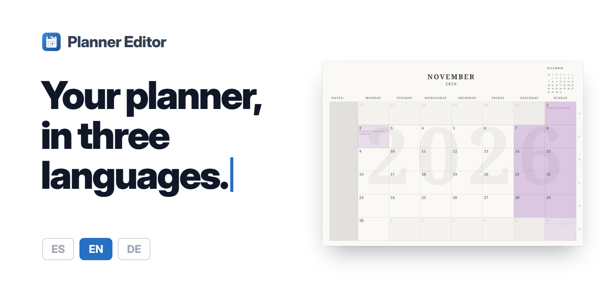
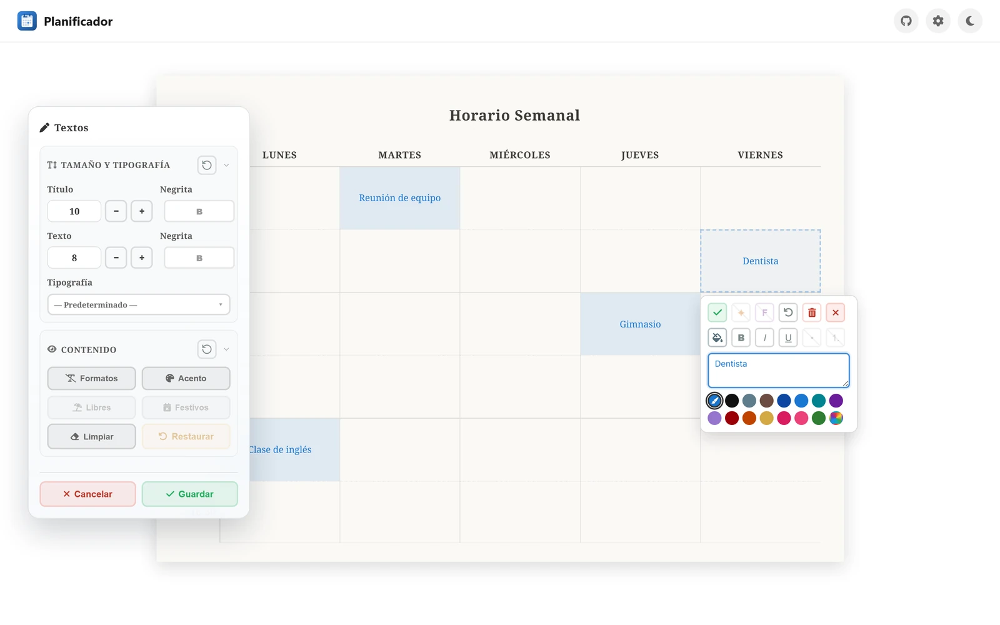
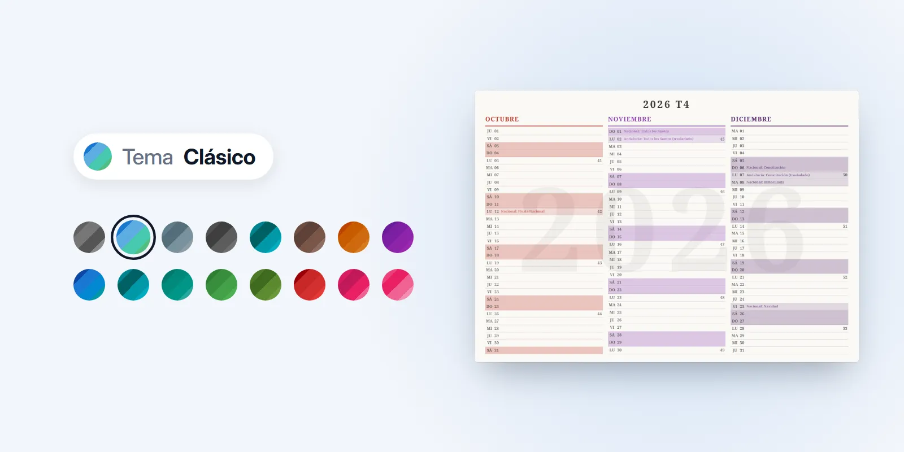
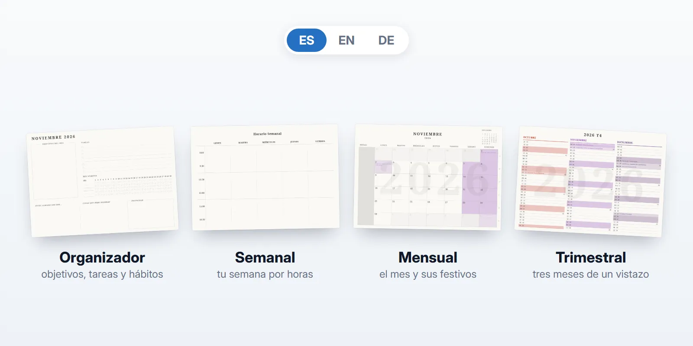
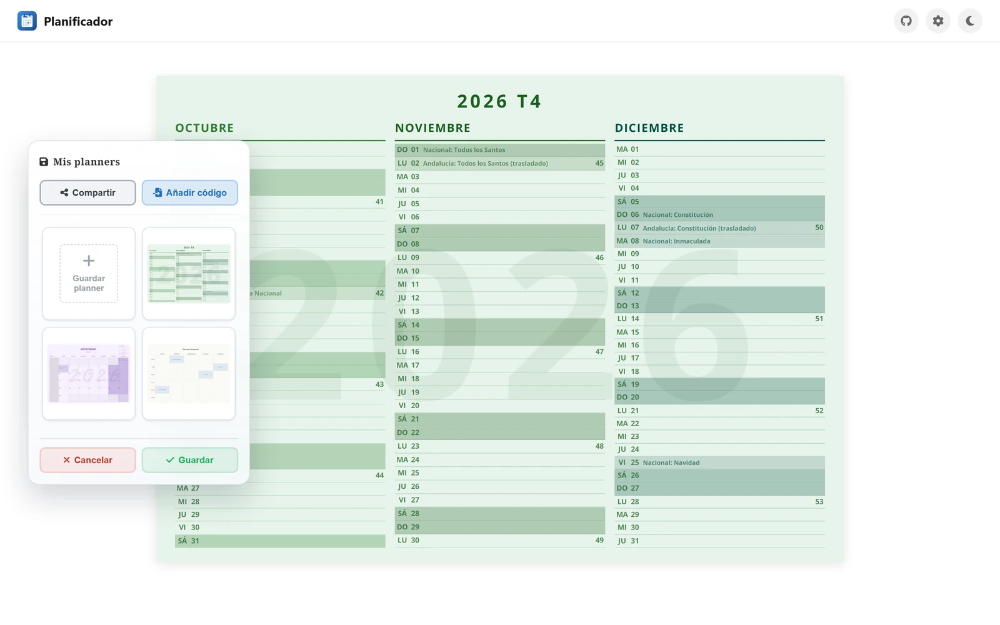

<div align="center">

<p><picture>
  <source media="(prefers-reduced-motion: reduce)" srcset="docs/images/header-still-es.webp">
  
</picture></p>

Un planner imprimible que diseñas en el navegador: 4 vistas, 16 temas, 11 tipografías, 3 idiomas, y un PDF o un JPG.<br>
Sin cuentas ni servidor: lo que haces se queda en tu ordenador.

<br>

[](#privacidad)
[](#privacidad)
[](#4-vistas-3-idiomas)
[](LICENSE)

<br>

<a href="#qué-hace"><b>Qué hace</b></a> &nbsp;·&nbsp;
<a href="#pruébalo"><b>Pruébalo</b></a> &nbsp;·&nbsp;
<a href="#hazlo-tuyo"><b>Hazlo tuyo</b></a> &nbsp;·&nbsp;
<a href="#cómo-está-hecho"><b>Cómo está hecho</b></a> &nbsp;·&nbsp;
<a href="#privacidad"><b>Privacidad</b></a> &nbsp;·&nbsp;
<a href="README.md"><b>English</b></a>

</div>

## Qué hace

### Escribe sobre la hoja

El planner es una hoja exacta y escribes directamente en ella: lo que ves es lo que se imprime. Cada celda admite
texto, con su color, negrita, cursiva y subrayado, y hay deshacer y rehacer.



### 16 temas

Cada tema trae sus colores, uno para cada mes, y su tipografía. Encima, tus propios colores de acento, de fondo y de
texto, y 11 tipografías con sus tamaños.

<p><picture>
  <source media="(prefers-reduced-motion: reduce)" srcset="docs/images/themes-es-still.webp">
  
</picture></p>

### 4 vistas, 3 idiomas

Organizador, semanal, mensual y trimestral, en horizontal, y el organizador también en vertical. La interfaz y el
calendario vienen en castellano, inglés y alemán, y tus textos pueden seguirlos: el planner los traduce con MyMemory,
cuando le das permiso.

<p><picture>
  <source media="(prefers-reduced-motion: reduce)" srcset="docs/images/views-es-still.webp">
  
</picture></p>

### Festivos

Los de España, de 2026: nacionales, por comunidad autónoma y por capital de provincia, cada uno con su nombre en el
idioma del planner.

### Todos tus planners, en tu navegador

Guarda hasta 25, con miniatura, y cambia de uno a otro. Comparte uno con un código corto que otra persona pega en el
suyo: no se sube nada.



### Un PDF o un JPG

Descárgalo en PDF o en JPG, o imprímelo desde el navegador.

## Pruébalo

Hay una demo en la web del autor: **[davidmcaru.com/app/planner/editor](https://davidmcaru.com/app/planner/editor/)**.
Es la versión de esa web, que sigue las condiciones de la web; lo demás de esta página habla del código de este
repositorio.

## Hazlo tuyo

Necesitas Node 22.13 o posterior, o Node 24.

```bash
git clone https://github.com/davidmcaru/app-planner-editor
cd app-planner-editor
npm ci
npm run dev
```

1. **Tu enlace.** En una copia tuya, pon tu repositorio en `components/core/app-config/app.config.ts`: la cabecera y
   el pie enlazan a él, como pide la licencia. En el mismo archivo hay una marca de agua para lo que exportas, tu QR
   o tu logo desde `public/`, apagada.
2. **Tu aspecto.** Los temas y los estilos de texto están en `js/planner-themes.ts`, y los textos de la interfaz, en
   `i18n/`, con las mismas claves en los tres idiomas. Una tipografía va en cuatro sitios: su archivo en
   `public/fonts/`, su `@font-face` en `css/planner-fonts.css`, su entrada en
   `components/features/fonts/font-registry.ts`, de donde la toma la exportación, y su estilo de texto en
   `TEXT_STYLES` y `FONT_DEFAULTS`, en `js/planner-themes.ts`, que llenan el menú de tipografías. La app abre en el
   idioma que diga `defecto` de `AJUSTE_IDIOMA`, en `components/core/ajustes/ajustes-general.ts`: `es` o `en`.
3. **Tus festivos.** `js/planner-holidays.ts` cubre España en 2026, y un año que no está no enseña festivos a
   propósito: adivinarlos daba fechas que parecían buenas y no lo eran. `node tools/generate-holidays-year.js 2027`
   saca el esqueleto de otro año; comprueba cada fecha con el calendario oficial (en España, el BOE) antes de pegarlo.
4. **Publícalo.** `npm run build` deja un sitio estático en `dist/`. Para una subcarpeta, como sirve GitHub Pages un
   proyecto: `VITE_BASE=/nombre-del-repositorio/ npm run build`, o en PowerShell
   `$env:VITE_BASE='/nombre-del-repositorio/'; npm run build`.

## Cómo está hecho

TypeScript y CSS, sin ningún framework de interfaz; lo construye Vite. `js/` es el planner, `components/` las piezas
compartidas (diálogos, paneles, almacenamiento, exportación, tipografías) y `css/` sus estilos, también los de
imprimir. Las tipografías están en `public/fonts/`, y los iconos y la librería de PDF vienen de npm, así que no se
carga nada de una CDN. La traducción pasa por `components/features/translate/traducir.ts`, por si prefieres otro
servicio.

Comprobaciones: `npm run typecheck`, `npm run lint` y `npm run format:check`. Los tests son de Playwright, en Chromium
y WebKit: ejecuta una vez `npx playwright install chromium webkit` y después `npm test`.

## Privacidad

Lo que escribes y diseñas se guarda en el almacenamiento local de tu navegador y en ningún otro sitio: sin cuentas, sin
analítica y sin cookies. Lo único que se pide fuera es la traducción automática, a MyMemory, y solo cuando le das
permiso; el engranaje de arriba cambia tu respuesta.

## Licencia

[AGPL-3.0](LICENSE), de [davidmcaru](https://github.com/davidmcaru) ([davidmcaru.com](https://davidmcaru.com)). Lo que
haces con la app, tus planners y tus PDF, es tuyo. Las tipografías y las librerías conservan sus propias licencias:
están en [CREDITS.md](CREDITS.md).

Las incidencias son bienvenidas; las pull requests, por ahora, no.
