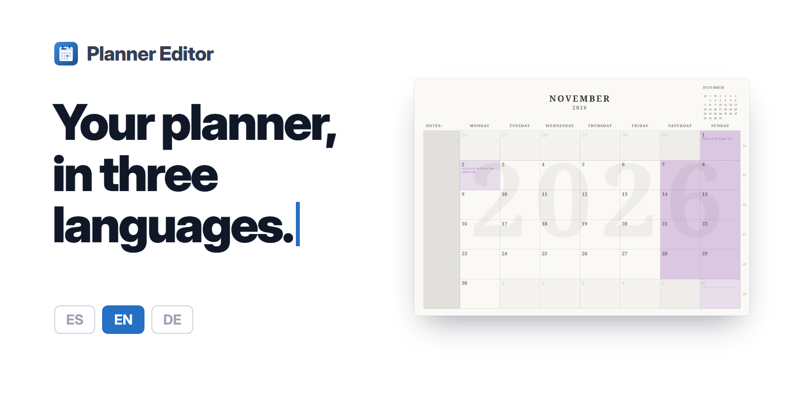
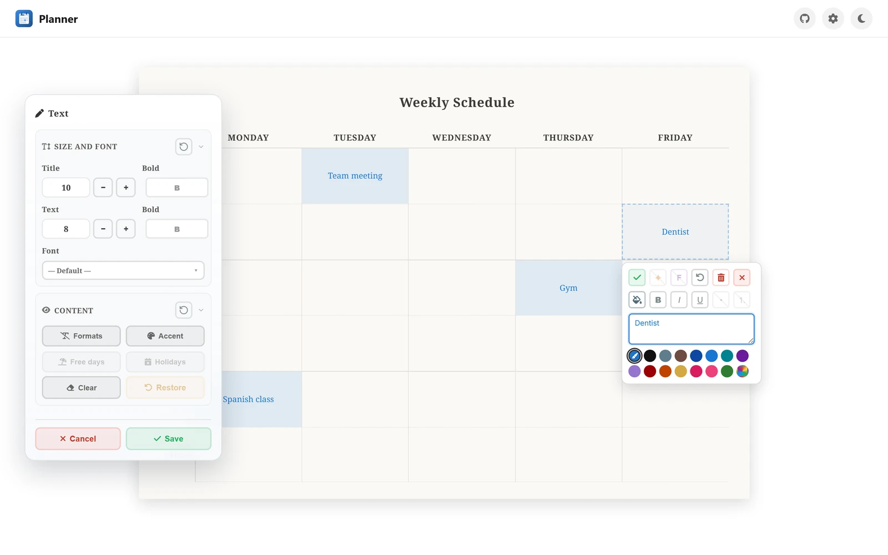
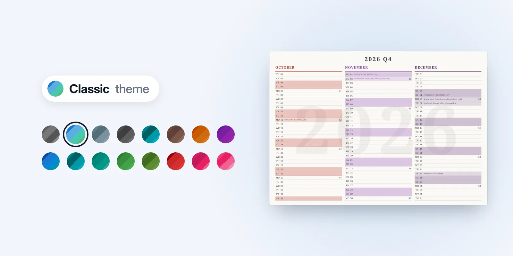
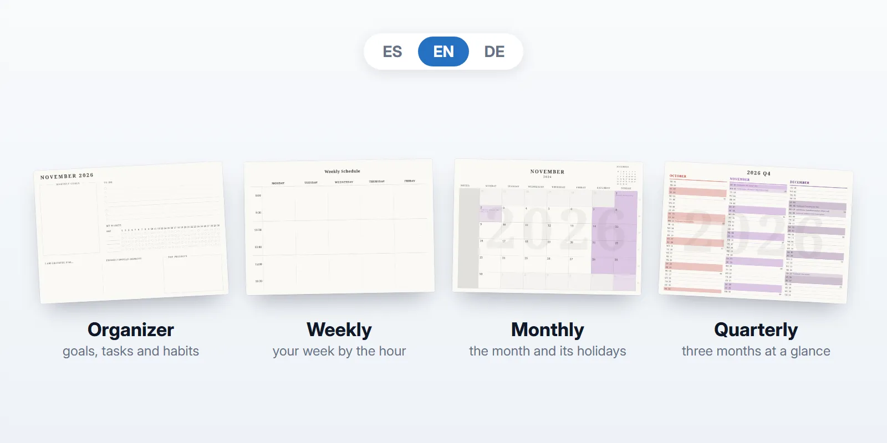
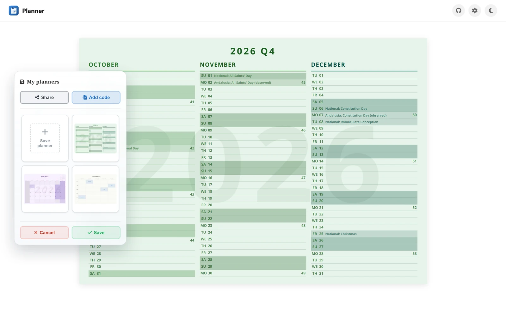

<div align="center">

<p><picture>
  <source media="(prefers-reduced-motion: reduce)" srcset="docs/images/header-still-en.webp">
  
</picture></p>

A printable planner you design in your browser: 4 views, 16 themes, 11 typefaces, 3 languages, and a PDF or a JPG.<br>
No accounts and no server: what you make stays on your computer.

<br>

[](#privacy)
[](#privacy)
[](#4-views-3-languages)
[](LICENSE)

<br>

<a href="#what-it-does"><b>What it does</b></a> &nbsp;·&nbsp;
<a href="#try-it"><b>Try it</b></a> &nbsp;·&nbsp;
<a href="#make-it-yours"><b>Make it yours</b></a> &nbsp;·&nbsp;
<a href="#how-its-built"><b>How it's built</b></a> &nbsp;·&nbsp;
<a href="#privacy"><b>Privacy</b></a> &nbsp;·&nbsp;
<a href="README.es.md"><b>Español</b></a>

</div>

## What it does

### Write on the page

The planner is an exact sheet and you write straight on it: what you see is what prints. Every cell takes text, with
its own colour, bold, italics and underline, and there's undo and redo.



### 16 themes

Each theme brings its colours, one for each month, and its typeface. On top of that, your own accent, background and
text colours, and 11 typefaces with their sizes.

<p><picture>
  <source media="(prefers-reduced-motion: reduce)" srcset="docs/images/themes-en-still.webp">
  
</picture></p>

### 4 views, 3 languages

Organizer, weekly, monthly and quarterly, in landscape, and the organizer in portrait too. The interface and the
calendar come in Spanish, English and German, and your own texts can follow them: the planner translates them with
MyMemory, once you allow it.

<p><picture>
  <source media="(prefers-reduced-motion: reduce)" srcset="docs/images/views-en-still.webp">
  
</picture></p>

### Public holidays

Spain's, for 2026: national, by autonomous community and by provincial capital, each named in the planner's language.

### All your planners, in your browser

Save up to 25, with thumbnails, and switch between them. Share one as a short code that someone else pastes into
theirs: nothing is uploaded.



### A PDF or a JPG

Download it as a PDF or a JPG, or print it straight from your browser.

## Try it

A demo runs on the author's website: **[davidmcaru.com/app/planner/editor](https://davidmcaru.com/app/planner/editor/)**.
It's that site's own version, which follows the site's terms; the rest of this page is about the code in this
repository.

## Make it yours

You need Node 22.13 or later, or Node 24.

```bash
git clone https://github.com/davidmcaru/app-planner-editor
cd app-planner-editor
npm ci
npm run dev
```

1. **Your link.** In a fork, put your repository in `components/core/app-config/app.config.ts`: the header and the
   footer link to it, as the license asks. The same file has a watermark for what you export, your QR or logo from
   `public/`, switched off.
2. **Your look.** The themes and text styles are in `js/planner-themes.ts` and the interface texts in `i18n/`, with the
   same keys in the three languages. A typeface goes in four places: its file in `public/fonts/`, its `@font-face` in
   `css/planner-fonts.css`, its entry in `components/features/fonts/font-registry.ts`, where the export takes it from,
   and its text style in `TEXT_STYLES` and `FONT_DEFAULTS`, in `js/planner-themes.ts`, which fill the typeface menu.
   The app opens in the language set as `defecto` of `AJUSTE_IDIOMA`, in
   `components/core/ajustes/ajustes-general.ts`: `es` or `en`.
3. **Your holidays.** `js/planner-holidays.ts` covers Spain in 2026, and a year that isn't there shows no holidays on
   purpose: guessing them gave dates that looked right and were wrong. `node tools/generate-holidays-year.js 2027`
   prints a skeleton for another year; check every date against the official calendar (in Spain, the BOE) before you
   paste it in.
4. **Publish it.** `npm run build` leaves a static site in `dist/`. For a subfolder, as GitHub Pages serves a
   project: `VITE_BASE=/repository-name/ npm run build`, or in PowerShell
   `$env:VITE_BASE='/repository-name/'; npm run build`.

## How it's built

TypeScript and CSS, with no UI framework; Vite builds it. `js/` is the planner, `components/` the shared pieces
(dialogs, panels, storage, export, fonts) and `css/` its styles, print included. The typefaces are in `public/fonts/`
and the icons and the PDF library come from npm, so nothing is loaded from a CDN. The translation goes through
`components/features/translate/traducir.ts`, if you'd rather use another service.

Checks: `npm run typecheck`, `npm run lint` and `npm run format:check`. The tests are Playwright's, on Chromium and
WebKit: run `npx playwright install chromium webkit` once, then `npm test`.

## Privacy

What you write and design is saved in your browser's local storage and nowhere else: no accounts, no analytics and no
cookies. The only request to anyone else is the automatic translation, to MyMemory, and only once you allow it; the
gear at the top changes your answer.

## License

[AGPL-3.0](LICENSE), by [davidmcaru](https://github.com/davidmcaru) ([davidmcaru.com](https://davidmcaru.com)). What
you make with the app, your planners and your PDFs, is yours. The typefaces and libraries keep their own licenses:
see [CREDITS.md](CREDITS.md).

Issues are welcome; pull requests aren't, for now.
